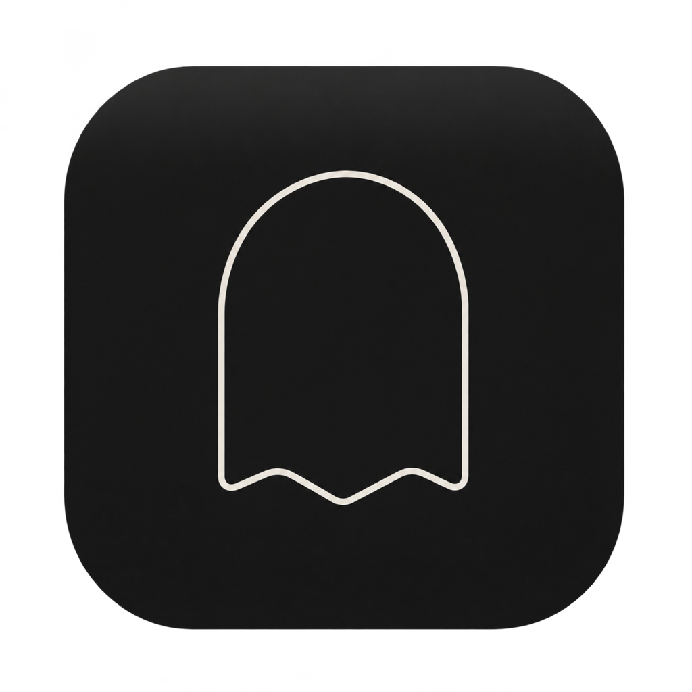
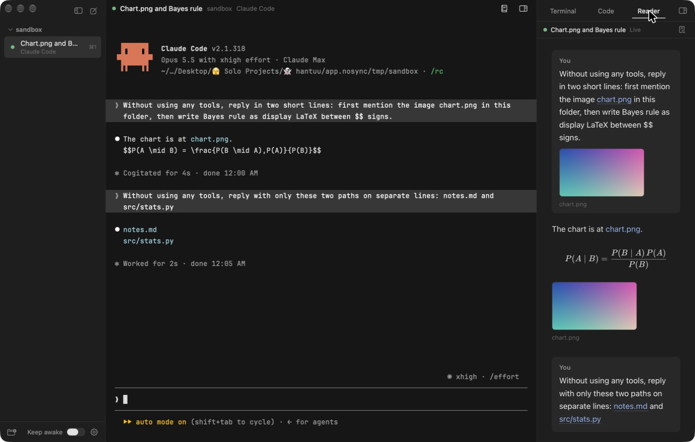
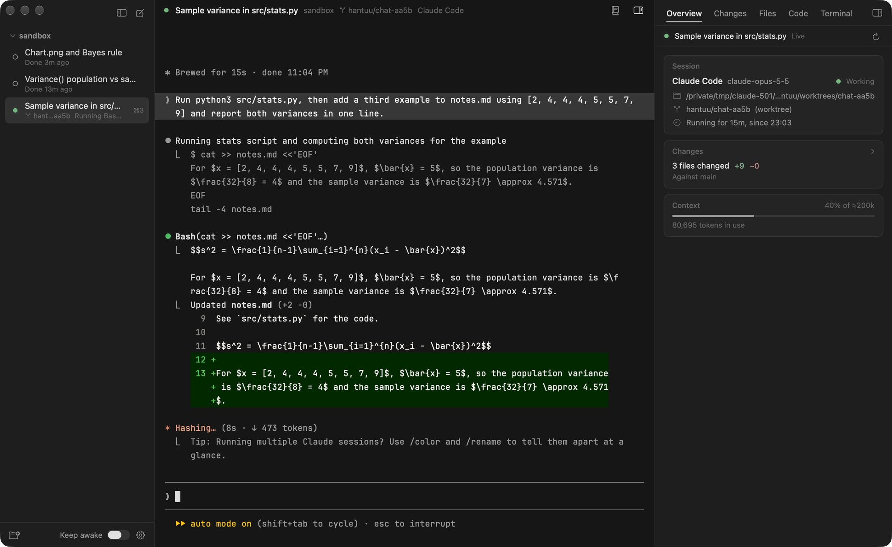
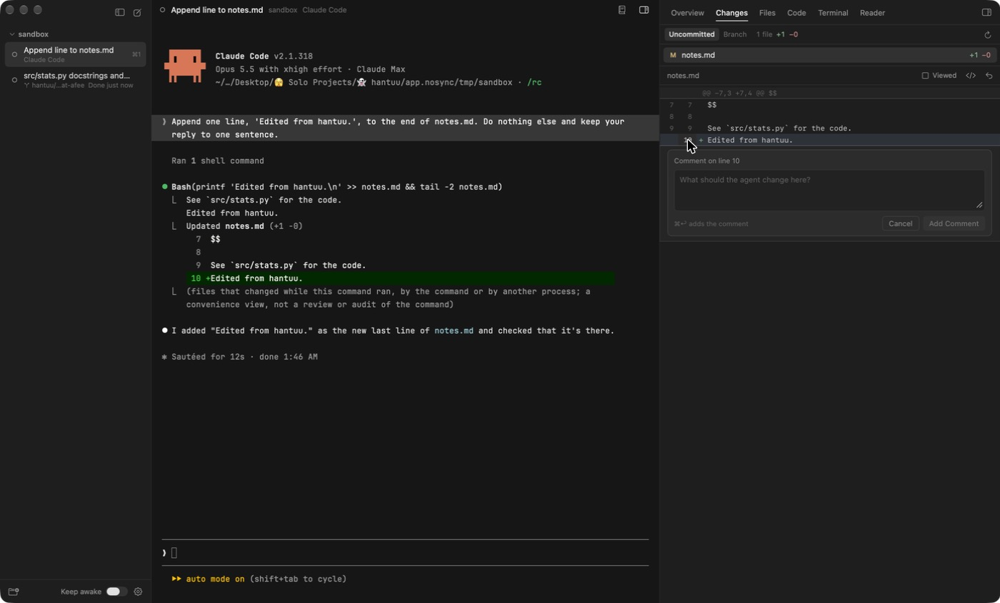
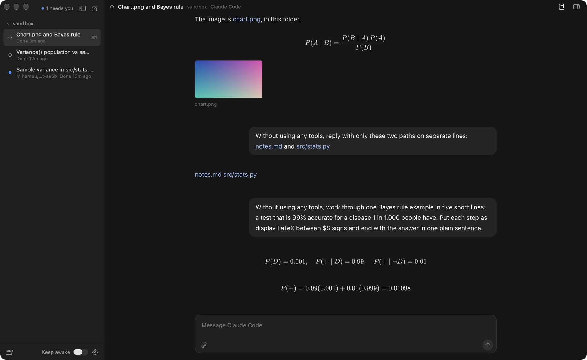
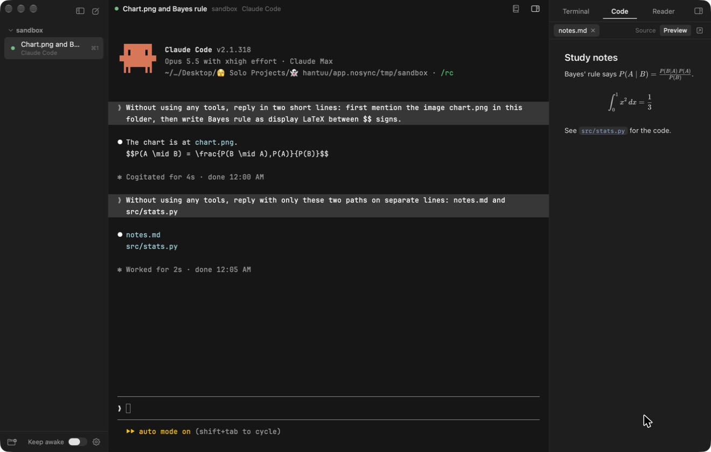

<p align="center">
  
</p>

# hantuu

hantuu is a native Mac app for running coding agents like Claude Code and Codex. Every chat is a real terminal powered by Ghostty, and next to it sits a reader that turns the conversation into something easy to read, with images, PDFs and LaTeX rendered properly. If you'd rather not read the terminal at all, reader mode makes the reader the chat itself.

The name comes from "hantu", the Malay word for ghost, made a little cuter the same way Ghostty did with "ghost".



## Why I built this

I use coding agents like Claude Code and Codex for my own projects, and I also use Claude to study. A few things kept getting in my way.

- Terminal chats are hard to read. When the agent points at an image or a PDF, all I see is a file path, and maths shows up as raw LaTeX. That's fine for code, but it gets painful when I'm studying for an exam and having Claude teach me.
- Once I have a few agents going across different projects, they end up spread over a pile of terminal tabs, and it's hard to keep track of them all.
- Starting a chat meant opening a terminal, going to the right folder and launching the agent myself, every single time.
- I wanted agents to keep working after I close my MacBook's lid.

I also wanted it to feel like a proper Mac app. hantuu is written in Swift and built on Ghostty, the terminal I already use, so each agent's own interface works exactly the way it does there.

## What it does

### All your agents in one sidebar

Add a project folder and its chats show up underneath it. Each chat takes its name from the title the agent gives it. Chats keep running in the background when you switch between them, and Cmd-1 to Cmd-9 jump straight to one.

### Know which agent needs you

Every chat shows what its agent is doing, so you don't have to click through each one to check. A small dot shows the state:
- a slow pulse while it's working
- amber when it's waiting for your permission or your answer
- blue when it finished while you were looking at something else
- hollow when it's idle

A line under the chat name says what's happening, like "Wants to run Bash: npm test", "Asks: Which database should I use?" or "Done 2m ago".

When something is waiting, the top of the sidebar says how many chats need you, and Cmd-J jumps to the next one. hantuu also sends a macOS notification that quotes the actual question, and clicking it opens that chat. The Dock icon shows the count too. The order of your chats never changes on its own, so Cmd-1 to Cmd-9 always mean the same thing.

The states come from Claude Code's own hooks and Codex's own notifications, which hantuu passes to each chat when it starts. Your Claude and Codex settings files are never touched.



### Agents keep running when you quit

Quitting hantuu, updating it or a crash doesn't stop your agents anymore. Each chat runs inside a small helper called `hantuu-session` that keeps the agent's terminal alive on its own. When you open hantuu again, the chat reattaches to the same agent with its screen where you left it. With Keep awake on, that means long runs keep going with the lid shut even if hantuu isn't open.

You can switch this off in Settings, and closing a chat still stops its agent. Chats that did end stay in the list, and Resume picks the conversation back up.

### A worktree per chat

File > New Chat in Worktree (Shift-Cmd-N), or the switch in the new chat popup, starts a chat on its own branch in its own git worktree. That way a few agents can work in the same repo without stepping on each other. The branch shows under the chat's name, and files listed in a `.worktreeinclude` file (like `.env`) get copied in. When you close the chat, hantuu offers to delete the worktree and branch, and it keeps them by default if there's work in them that isn't anywhere else.

### New chat opens straight into your agent

Cmd-N opens your default agent in the selected project, so you're talking to it right away. Hover the new chat button to pick a different agent. hantuu finds the agents you have installed through your login shell, so they run with the same setup they have in your normal terminal. It never adds flags that skip an agent's permission prompts.

### Review the agent's changes without leaving hantuu

The right panel has six tabs: Overview, Changes, Files, Code, Terminal and Reader.

Overview is a column of cards for the selected chat. They cover:
- the session and its branch
- what changed compared with the branch it started from
- the pull request and its CI checks, if there is one
- how much of the context window is used
- the agent's plan
- any localhost ports it's running

Each card only shows up when it has something to say.

Changes shows every changed file with a highlighted diff. Click a line number to leave a comment on that line, or Shift-click for a range. When you're done, Cmd-Enter sends all your comments to the agent as one message, with the file and line for each. You can also mark files as viewed or revert one.

Files is the project tree with a filter, and files with changes get a small dot. Click a file to open it in Code, or Option-click to type its path into the chat.



### A reader for the chat

Open the Reader tab and it follows the conversation as it happens. Your messages sit on the right and the agent's answers read like a normal document. A run of tool calls folds into one line, like "Ran a command, read a file and 1 more", and you can open it to see each step. The agent's thinking is hidden, but permission requests, errors and questions to you always stay visible.

Images and PDFs that come up in the chat appear inline instead of as paths. LaTeX is rendered with KaTeX, and code blocks are highlighted with a Copy button. That's what makes it usable for studying.

### Reader mode

If you'd rather not read the terminal at all, turn on "Show chats as the reader" in Settings > Chat. Chats then open as the reader, with a message box underneath. The agent still runs in its own terminal behind it, so logging in, slash commands and the status dots all work the same.

- Return sends and Shift-Return adds a line. Dropping files on the box types their paths.
- While the agent works, a line above the box says what it's doing. Esc or the Stop button stops it.
- When it wants your permission or asks a question with options, a banner says so. Show Terminal brings up the terminal so you can answer there, and the reader comes back once the agent carries on.
- Option-Cmd-R switches one chat between the reader and its terminal, whichever way the setting is.



### File links that open somewhere useful

Every file path in the chat becomes a link. Text and code files open in the Code tab with syntax highlighting and line numbers, and Markdown files also get a rendered preview. Anything else, like a PDF, is shown in Finder so you can open it with the app you normally use. Cmd-click works on links in the terminal too.



### Terminals right next to the chat

The Terminal tab holds as many plain shells as you want, already open in the project folder. Dropping a file onto a chat or a shell types in its path, which is the quickest way to hand the agent a screenshot or a PDF.

### Keep your Mac awake

One switch at the bottom of the sidebar keeps your Mac running even with the lid shut, so long agent runs don't stop when you close it. It uses macOS's own `pmset disablesleep` setting, asks for your password through the normal system prompt, and shows the real state even if you change it somewhere else.

### Feels like part of your Mac

hantuu is dark and minimal, and it uses native Mac controls throughout. The terminals come with hantuu's own quiet dark theme. To use your own Ghostty config instead, with your font, colours and padding, turn it on in Settings > Terminal.

## Get started

You'll need:

- A Mac with Apple silicon on macOS 26 or later
- Xcode 26
- About 2.5 GB of free space for the Ghostty build
- At least one agent installed, like [Claude Code](https://docs.claude.com/en/docs/claude-code) or [Codex](https://github.com/openai/codex)

Clone the repo and build Ghostty's terminal library. This downloads Zig and the Ghostty 1.4.0 source into `vendor/` and takes a few minutes the first time.

```bash
git clone https://github.com/weilun1910/hantuu.git
cd hantuu
scripts/build-libghostty.sh
```

Then build it, install it in your Applications folder and open it:

```bash
scripts/run.sh
```

Run it again whenever you pull changes. It always replaces the same `/Applications/hantuu.app` and makes macOS forget any other copy, so Spotlight, Launchpad and the Dock only ever show one hantuu. `scripts/install.sh` does the same without opening it.

Your projects and chats are saved in `~/Library/Application Support/hantuu/`. To try things without touching them, point it at a scratch folder:

```bash
scripts/run.sh --data-dir "$PWD/tmp/appdata"
```

### Shortcuts

| Shortcut | What it does |
| --- | --- |
| Cmd-N | New chat with your default agent |
| Shift-Cmd-N | New chat in its own worktree |
| Cmd-J | Jump to the next chat that needs you |
| Option-Cmd-R | Switch the chat between the reader and its terminal |
| Shift-Cmd-O | Add a project folder |
| Cmd-1 to Cmd-9 | Jump to a chat |
| Option-Cmd-0 | Show or hide the right panel |
| Option-Cmd-1 to 6 | Overview, Changes, Files, Code, Terminal or Reader tab |
| Cmd-T | New shell tab |
| Cmd-O | Open a file in the Code tab |
| Cmd-0 | Show or hide the sidebar |

## How it works

- The app is written in Swift, with AppKit for the window and SwiftUI for the sidebar and panels.
- The terminals are libghostty, built from the official Ghostty 1.4.0 source by `scripts/build-libghostty.sh`. One small patch in `patches/` compiles Ghostty's Metal shaders when the app starts, because Xcode 26 doesn't include the Metal toolchain that Ghostty's build expects.
- `hantuu-session` is a small helper in C, in the style of dtach, that holds each agent's terminal outside the app. It replays recent output and makes the agent redraw when you reattach.
- Agent status comes from hooks passed to each chat on the command line (`claude --settings` for Claude Code, a `notify` override for Codex), with the transcripts filling in the rest. No permission-skipping flag is ever added.
- The reader reads the transcript files the agents already write, in `~/.claude/projects/` for Claude Code and `~/.codex/sessions/` for Codex. It only ever reads them.
- The review tabs read git through a private copy of the index, because a plain `git diff` rewrites the real one and can get in the way of the agent's own commits.
- The reader and code viewer are local web pages bundled with markdown-it, KaTeX and highlight.js, so nothing loads from the internet.
- In reader mode, your message is typed into the agent's terminal as one paste followed by Return, the same as typing it yourself. Nothing is sent while a menu is waiting there, because Return would answer it.
- Light and dark use Ghostty's own `theme = light:…,dark:…` switching. hantuu ships a light and a dark terminal theme, and tells every terminal which one to show when you change the setting or macOS switches. If you use your own Ghostty config and it has a pair like that, it follows along too.
- `scripts/selftest.sh` runs 400 checks. They cover transcript parsing, link handling, a live Ghostty terminal and the reader page. They also cover agent status, sessions that survive their client, worktrees, the review tabs and reader mode.

## Status

This is v2. v1 was the first version I built to try out the idea, and v2 adds agent status, the review tabs, agents that keep running, and worktree chats. Since then, it has gained reader mode, a setting that shows chats as the reader with a message box, and light mode, which can follow macOS. Expect some rough edges. A companion iOS app for checking on chats from my phone is planned once the desktop app settles. A signed, notarized download isn't there yet.

## License

hantuu is released under the [MIT License](LICENSE).

## Credits

hantuu is built on [Ghostty](https://github.com/ghostty-org/ghostty) by Mitchell Hashimoto and the Ghostty contributors. The terminal hosting code is adapted from Ghostty's own macOS app. Reader mode takes its layout ideas from [T3 Code](https://github.com/pingdotgg/t3code). Licenses for Ghostty and the bundled libraries are in [THIRD_PARTY_NOTICES.md](THIRD_PARTY_NOTICES.md). The icon is a placeholder generated with Codex.
