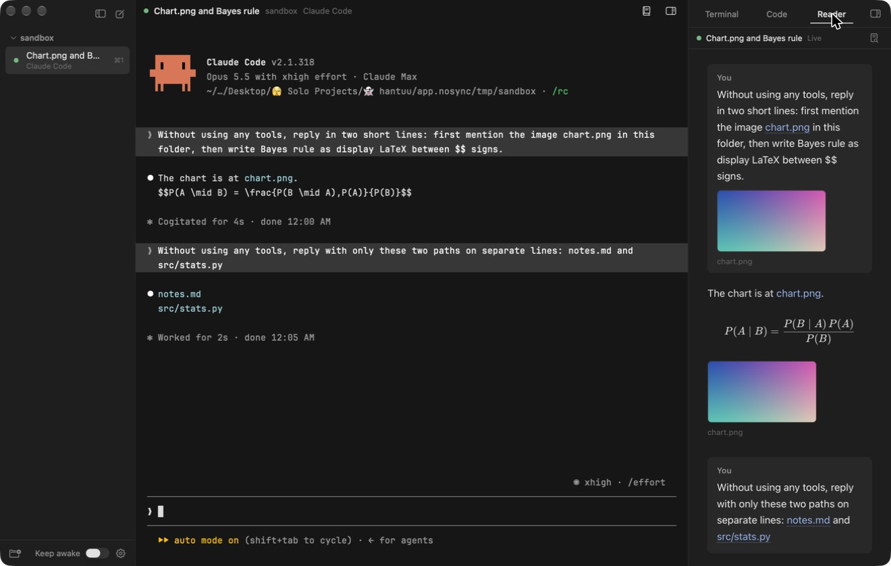
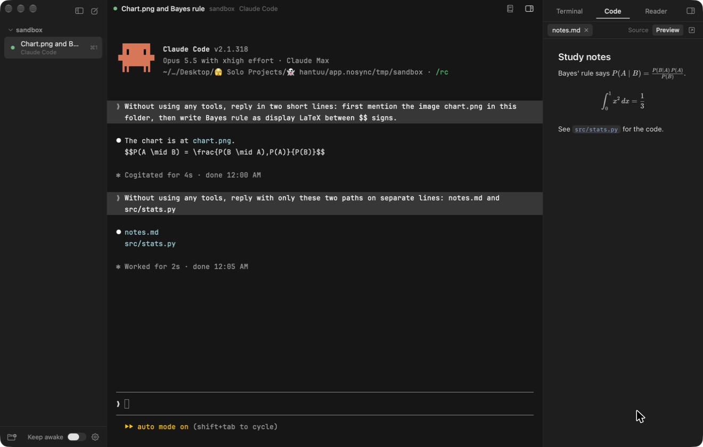

# hantuu 1.0

Released 5 November 2026.

1.0 is the first version of hantuu. It runs Claude Code and Codex in real Ghostty terminals, all in one window, with a reader next to each chat that shows images, PDFs and maths properly.

## New

### All your agents in one sidebar

Add a project folder and its chats show up underneath it. Each chat takes its name from the title the agent gives it, and keeps running in the background when you switch to another one. **Cmd-1 to Cmd-9** jump straight to a chat.

A small dot says whether the agent is running, needs you or has ended. Ended chats stay in the list after you quit, and **Resume** picks the conversation back up.

### New chat opens straight into your agent

**Cmd-N** opens your default agent in the selected project, so you can start typing right away. Hover the new chat button to pick a different agent. hantuu finds your agents through your login shell, so they run with the same setup they have in your normal terminal. It never adds flags that skip an agent's permission prompts.

### A reader for the chat

Terminal chats get hard to read when the agent points at an image or writes maths. The **Reader** tab in the right panel follows the conversation and shows it like a normal document.

- **Images and PDFs** from the chat appear inline instead of as file paths.
- **LaTeX** is rendered with KaTeX, and code blocks are highlighted.
- Tool calls fold down to one line each, and the agent's thinking is hidden.
- Permission requests, errors and questions to you **always stay visible**.

### File links that open somewhere useful

Every file path in the chat becomes a link. Text and code files open in the **Code** tab with syntax highlighting and line numbers, and Markdown files also get a rendered preview. Anything else, like a PDF, is shown in Finder so you can open it with the app you normally use. Cmd-click works on links in the terminal too.

### Terminals right next to the chat

The **Terminal** tab holds as many plain shells as you want, already open in the project folder. Dropping a file onto a chat or a shell types in its path, which is the quickest way to hand the agent a screenshot or a PDF.

### Keep your Mac awake

The **Keep awake** switch at the bottom of the sidebar keeps your Mac running with the lid shut, so long agent runs don't stop when you close it. It uses macOS's own `pmset disablesleep` setting and asks for your password through the normal system prompt.

### Built on Ghostty

Every chat is a real terminal built from the official **Ghostty 1.4.0** source, so each agent's own interface works exactly the way it does in Ghostty. The terminals load your own Ghostty config, so your font, colours and padding carry over.
