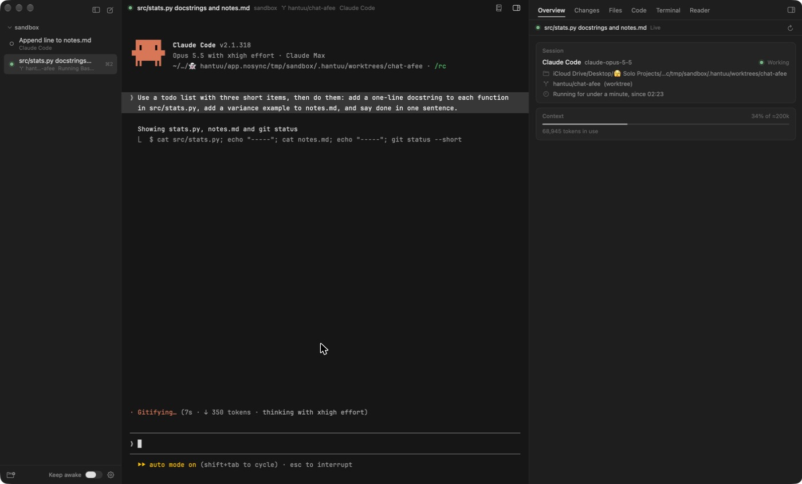
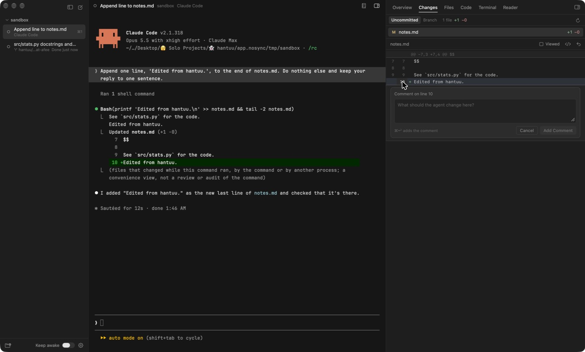

# hantuu 2.0

Released 5 November 2026.

2.0 is about running several agents at once and keeping track of them. It also lets you review an agent's changes without leaving hantuu.

## New

### Know which agent needs you

Every chat now shows what its agent is doing, so you don't have to click through each one to check.

- The dot **pulses slowly** while the agent works and turns **amber** when it's waiting for your permission or your answer.
- It turns **blue** when the agent finished while you were looking at something else.
- A grey line under the chat name says what's happening, like "Wants to run Bash: npm test" or "Done 2m ago".
- When something is waiting, the top of the sidebar says how many chats **need you**, and **Cmd-J** jumps to the next one.
- A **macOS notification** quotes the agent's actual question, and clicking it opens that chat. The Dock icon shows the count too.

The states come from Claude Code's own hooks and Codex's own notifications, which hantuu passes to each chat when it starts. Your Claude and Codex settings files are never touched.

### Agents keep running when you quit

Quitting hantuu used to stop every agent. Now each chat runs inside a small helper called **hantuu-session**, which keeps the agent's terminal alive on its own. Quitting, updating or a crash leaves the agent running, and when you open hantuu again the chat **reattaches** with its screen where you left it.

You can turn this off in Settings. Closing a chat still stops its agent.

### A worktree per chat

A few agents working in the same repo can step on each other's files. **New Chat in Worktree** (Shift-Cmd-N) starts a chat on its own branch in its own git worktree, and the branch shows under the chat's name. Files listed in a `.worktreeinclude` file, like `.env`, get copied in. When you close the chat, hantuu offers to delete the worktree and branch, and keeps them by default if they hold work that isn't anywhere else.

### An Overview of each chat

The right panel now has six tabs, on Option-Cmd-1 to 6. The first, **Overview**, is a column of cards for the selected chat. They cover the session and its branch, what changed since the branch started, the pull request and its CI checks, how much of the context window is used, the agent's plan and any localhost ports it's running. Each card only shows up when it has something to say.

### Review changes and comment on lines

The **Changes** tab shows every file the agent changed, with a highlighted diff. Click a line number to leave a comment, or Shift-click for a range. **Cmd-Enter** sends all your comments to the agent as one message, with the file and line for each. You can also mark files as viewed or revert one.

hantuu reads git through a private copy of the index, because a plain `git diff` rewrites the real one and can get in the way of the agent's own commits.

### A Files tab

**Files** is the project tree with a filter, and files with changes get a small dot. Click a file to open it in Code, or Option-click to type its path into the chat.

### MIT license

hantuu is now released under the **MIT License**.

## Fixed

- The window **remembers its size** between launches. Before, setting up the window saved a new size over the remembered one before it could be restored.
- The right panel opens at 560 pt the first time it's shown. It used to open at its 300 pt minimum.
- The first window on a new install is larger.
- The reader works in a fresh clone of the repo. In 1.0, the reader's bundled markdown-it, KaTeX and highlight.js files were left out of the repo by mistake.
