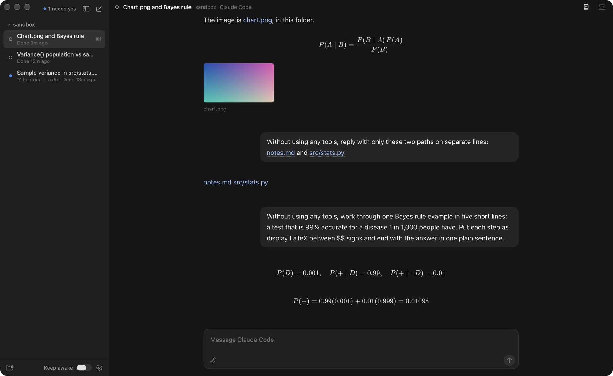
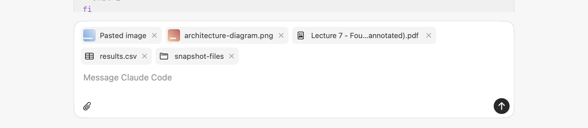
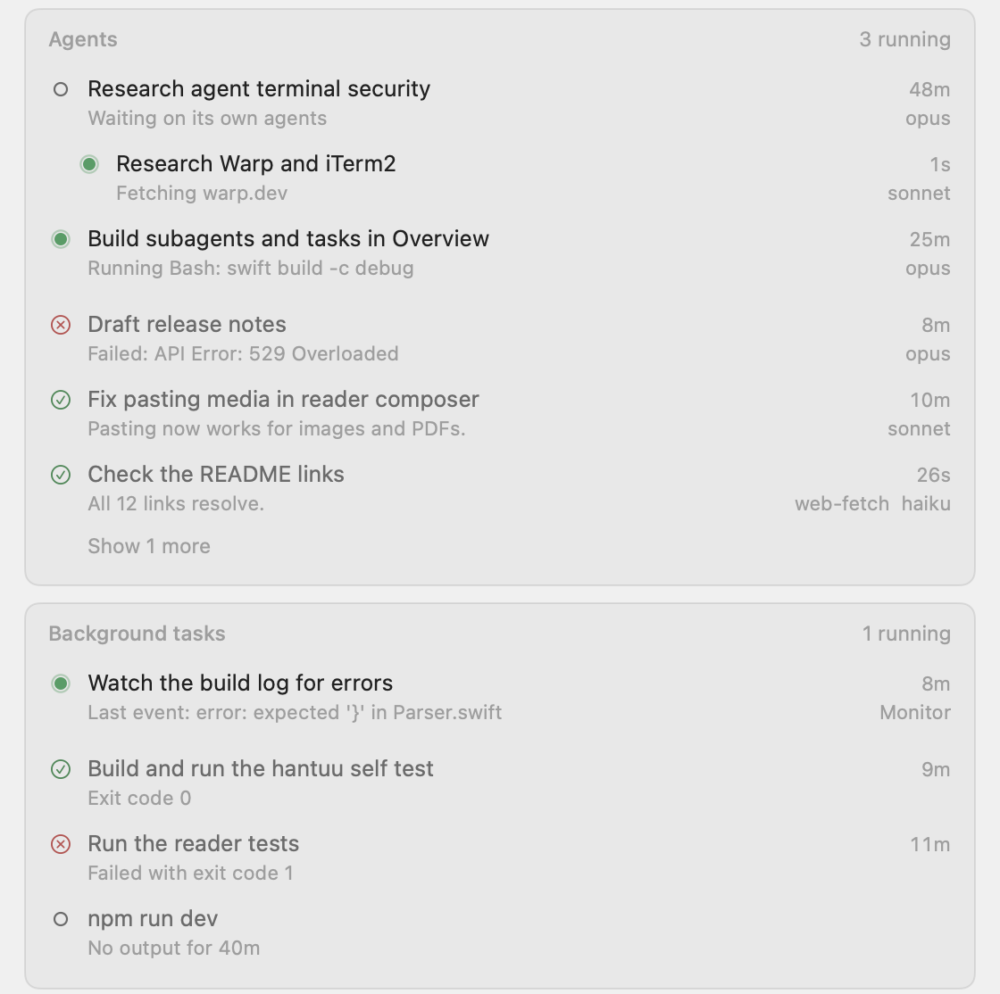
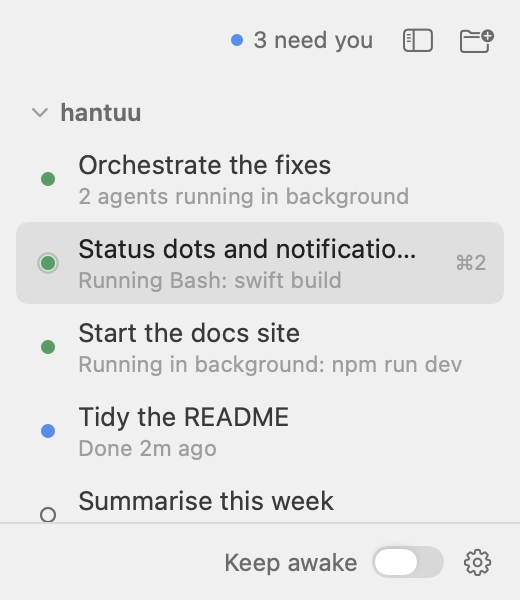
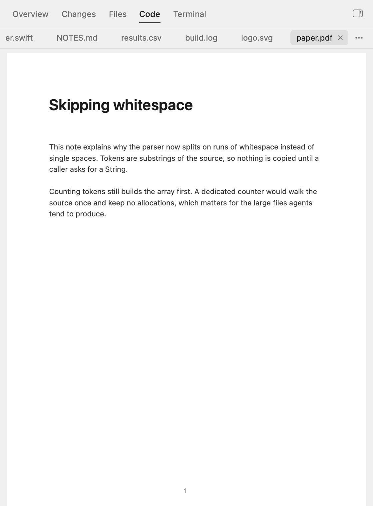
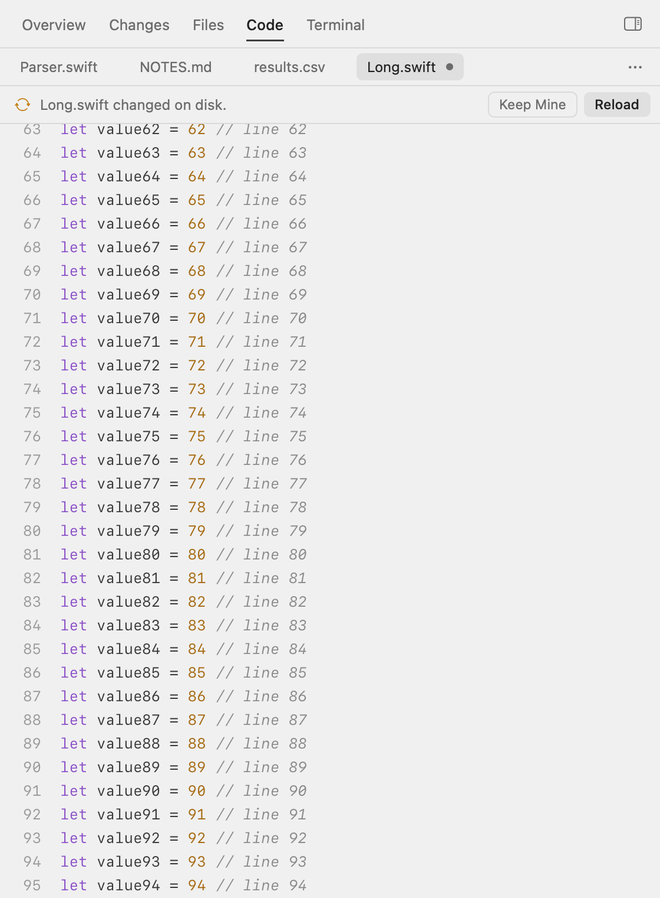
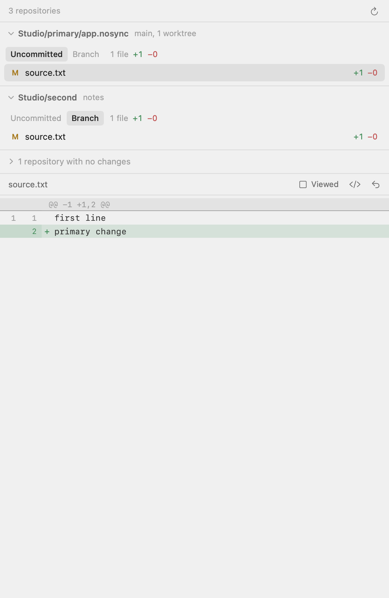
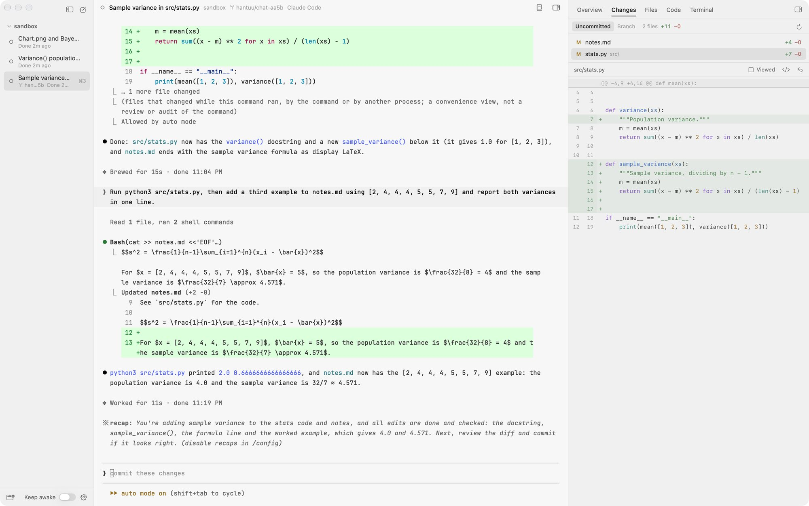
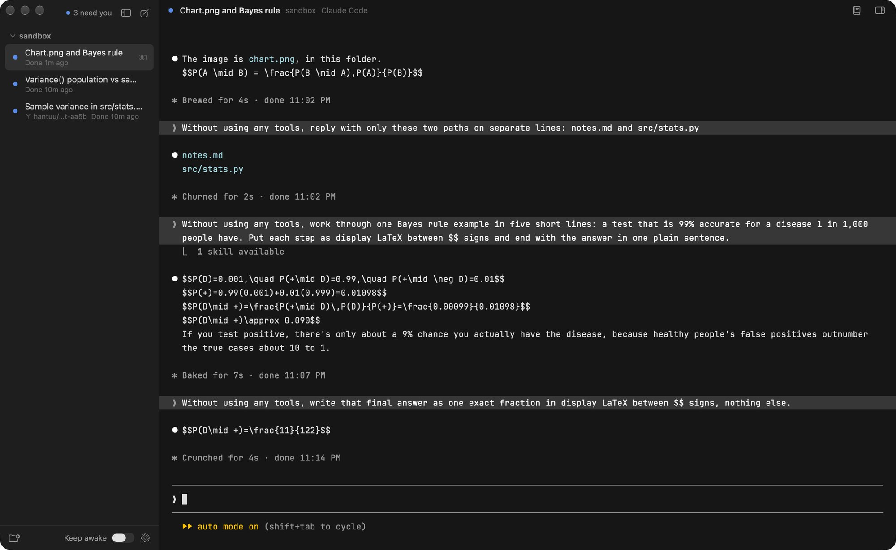

# hantuu 2.1

Released 11 November 2026.

In 2.1 the reader moves into the chat itself, and the Code tab can open and edit any file. hantuu also gets light mode, and Overview shows what each chat has running in the background.

## New

### Reader mode, right in the chat

In 2.0 the reader was a tab in the right panel. Now **Shift-Cmd-R**, or the book icon above the chat, turns the chat you're looking at into the reader, right where the terminal was. Press it again to get the terminal back. The agent keeps running in its terminal underneath, so slash commands and the status dots work the same.

Each chat remembers which one it was showing. Chats still open in the terminal unless you turn on **Show chats as the reader** in Settings > Chat. The panel's Reader tab is gone, and Resume Chat moved to **Shift-Cmd-T**.

### Talk to the agent from the reader

The reader has a **message box** at the bottom, so you can keep talking to the agent without going back to the terminal. What you send is typed into the agent's terminal the same way you'd type it yourself.

- Return sends and Shift-Return adds a line.
- **Screenshots and files** you paste, drop or pick with the paperclip show as chips above your text, and the agent gets each picture as a real image.
- While the agent works, a line above the box says what it's doing. **Esc** in the message box or the Stop button stops it.
- When the agent wants your permission or asks a question with options, a **banner** says so, and Show Terminal brings up the terminal so you can answer there.

Pasted pictures are saved in hantuu's data folder and deleted after a week. Each agent keeps its own copy, so older chats still show them.

### A cleaner reader

The reader's layout now follows **T3 Code**'s chat view, toned down to match the rest of hantuu.

- Your messages sit on the right, and the agent's answers read like a normal document.
- A run of tool calls folds into one line, like "Ran a command, read a file and 1 more", which opens to show each step.
- Code blocks get a header with the language and a **Copy** button.
- Images and PDFs in a message show as **compact previews** side by side. Click one to expand it to full width. Click again, use the shrink button or press Esc to shrink it.
- Expanded **PDFs** fit their pages to the reader's width and load them as you scroll. Switching size is instant. The pop-out button opens the file in the Code tab's full PDF viewer, with search and text selection.
- Codex's memory citations are hidden, and its plans show as **plan cards** the same way Claude Code's do.

<!-- Screenshot needed: the reader with two or three small image and PDF previews side by side in one message, one of them showing its pop-out button. Scratch data only. The self test's reader-media-small render shows a real home path, so retake it. -->

### The reader keeps up with the chat

When you run **/resume** or **/clear** inside a Claude Code chat, Claude moves to a different conversation. The reader now follows it there, and Resume Chat after a relaunch picks up the conversation you were last in.

Long conversations also **load in the background**. Opening a 44 MB one used to freeze hantuu for about 2.7 seconds, and the longest pause is now about 99% shorter.

### Subagents and background tasks in Overview

Overview has two new cards for the selected chat. **Agents** lists the subagents it started, running ones first with what each is doing now. Click one to see its task and its report. **Background tasks** lists background commands and monitors, and clicking one opens its output in the Code tab.

While any of these are still running, the sidebar says **Running in background** with a still green dot. It used to say Done. The Done notification now waits until everything has finished.

  
  

### The Code tab opens any file

The Code tab used to show code and text, and sent anything else to Finder. Now **PDFs, images, video, audio** and anything Quick Look can show open right in the panel. Links in the reader, the Files tab and Cmd-click in the terminal all open files there.

Code and text files are **editable**, with find, undo and Cmd-S, and a dot on the tab marks unsaved changes. If an agent changes a file while you have unsaved edits, a bar offers **Keep Mine** or **Reload**.

  
  

### Changes for folders that hold several repositories

A project folder that isn't a git repository itself, like a folder of side projects, used to show "Not a git repository" in **Changes**. Now Changes finds the **repositories inside it**, a few levels down, and gives each one its own section with its branch and its own Uncommitted and Branch switch.

- Repositories with changes come first and start open. The clean ones fold into one line.
- Git worktrees are counted under their main repository instead of showing up again.
- The search skips build and dependency folders, and never makes iCloud download a file to look inside.
- Overview's Changes card and the change dots in Files use the same list.

### Usage rings in the sidebar

A small ring for each agent at the bottom of the sidebar shows how much of its **weekly limit** is left. It turns amber under 15% and red under 5%. Hover for a **quick card** with every agent's weekly limit left, reset time, 5-hour window where there is one, and how old the reading is.

- Codex's numbers come from the session logs it already writes.
- Claude Code only shares its limits with a status line, and any status line hides its hints like "esc to interrupt". So the Claude ring is **off by default**, and you can turn it on in **Settings > Usage Limits**. It's already on if you use a status line of your own.
- hantuu never reads your agent logins or calls a usage API.

### Light mode

**Settings > Appearance** has System, Light and Dark, and System follows macOS when it switches. The window, the reader, the code viewer and every terminal change together, because hantuu ships its own light and dark terminal themes.

### hantuu's own terminal look

The terminals used to take their look from your own Ghostty config. hantuu now ships **its own look** for everyone, with JetBrains Mono at 13 pt, roomy padding and a neutral background. To use your own Ghostty config instead, turn on **Use my Ghostty config** in Settings > Terminal, and a light and dark theme pair in it follows the Appearance setting too.

### Pinned chats

Right-click a chat and choose **Pin Chat** to keep it in a **Pinned** section above your projects. Pinned chats from every project sit there together, and each row shows which project it's from. Cmd-1 to Cmd-9 count them first.

<!-- Screenshot needed: the sidebar with a Pinned section above two projects, holding chats from both, each row showing its project name. Scratch data only. -->

### New Project button

The button at the top of the sidebar is now **New Project** (Shift-Cmd-O). Its folder picker can make a new folder too, so you can start a project from scratch without leaving hantuu.

<!-- Screenshot needed: the folder picker opened from New Project, with the New Folder button and the Create Project button. Scratch data only. -->

### No idle sleep while agents work

While any agent is working, or still has subagents or background tasks running, hantuu keeps the Mac from **idle sleeping**. It lets go a minute after the last one stops. There's no switch and no password. Closing the lid still puts the Mac to sleep, so for lid-shut runs turn on **Keep awake** at the bottom of the sidebar.

### Keep awake turns itself off

**Keep awake** still keeps agents running with the lid shut. Before 2.1 it stayed on until you turned it off, even after hantuu quit or crashed, so a Mac could stay awake in a bag. Now it ends on its own.

- It turns off after **4 hours**, when no agent has worked for **10 minutes**, below **20% battery** on battery power, when the Mac runs **hot**, and when hantuu quits. Settings has each limit, and right-clicking the switch adds an hour.
- If hantuu crashes, a small background check turns sleep back on within about a minute.
- The first time you turn it on, the password prompt also lets hantuu turn sleep back on later without asking again. That permission covers only switching sleep back on. Settings can remove it.
- The line under the switch says how long it has left, or why it ended.

### Your sidebar survives updates

Updating hantuu never touches the file your projects and chats are saved in. But before 2.1, a new version that couldn't read that file would start with an empty sidebar and then save the empty sidebar over it. Now hantuu guards against that.

- A project or chat that can't be read is **skipped on its own**, and the rest still load.
- A file that can't be read at all is **moved aside**, and each launch keeps a copy of the last good one as `state.previous.json`.
- A project whose folder is missing for a while, like one on an unplugged drive, **comes back with its chats** when the folder does.

### One hantuu, updated in place

hantuu now installs into your **Applications folder**, and every update replaces that same copy. Old builds and test copies used to show up as extra hantuus in Spotlight, and now macOS forgets them after each install. Agents keep running through an update, because hantuu-session holds them.

## Fixed

- The **usage rings** now show their hover card reliably.
- Enlarged **PDFs** now shrink when you click them again.
- The agent list on a project's plus button now opens almost as soon as you hover it.
- Hovering an agent in that list no longer shows a tooltip with the agent's file path over the row below.
- Closing a chat only asks "Close this chat?" when its agent is in the middle of something, including subagents or background tasks it still has running. A chat sitting at its prompt closes straight away, and Resume brings it back.
- Claude Code's "waiting for your input" reminder no longer shows up in the reader as a Needs you card under almost every answer. The status dot still sees it.

