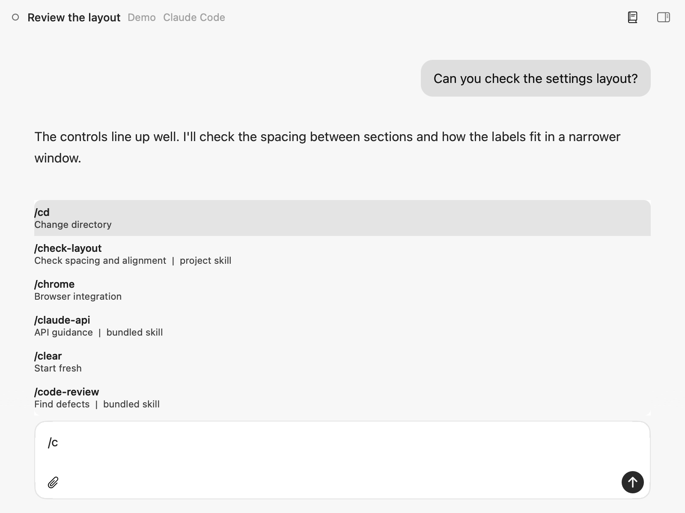
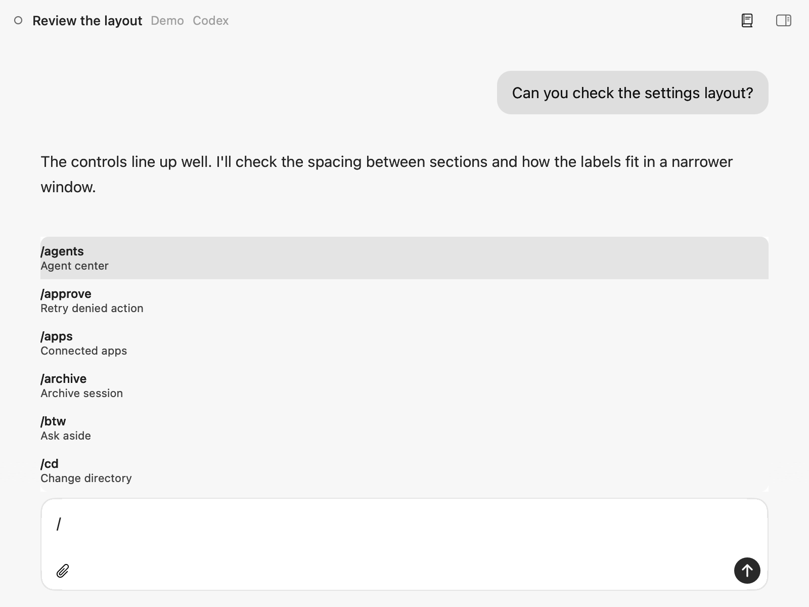
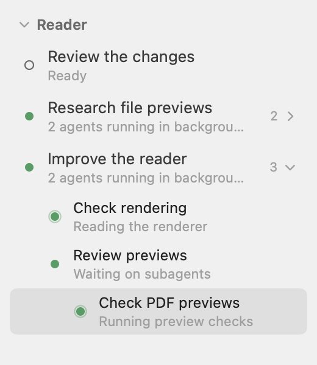
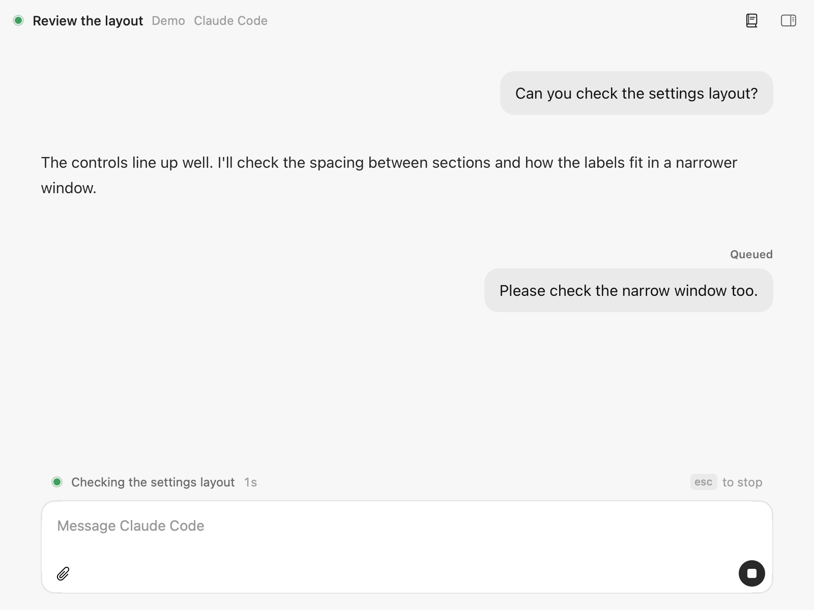

# hantuu 2.2

Released 11 November 2026.

In 2.2 you can use slash commands from the reader and see messages you've queued while an agent works. Subagents open under their chat in the sidebar, and the right panel remembers where you left off in each project.

## New

### Slash commands in the reader

Type **/** in the message box to browse the agent's own commands. Claude Code includes built-ins, personal and project commands, skills and plugins. Codex includes built-ins and saved prompts, with **$** to bring up its skills.

- **Tab** completes the selected command. The arrow keys move through the list.
- **Esc** closes the list without stopping the agent.
- Commands that open a picker, like **/model**, show the terminal so you can choose there. The reader comes back when you're done.

### Subagents under their chat

A chat with running subagents shows a **count and chevron** at the end of its row. Expand it to see each subagent and what it's doing. Subagents that launch more subagents have those nested underneath them.

Click one to read its conversation live in a **read-only reader**. Esc or Cmd-[ takes you back to the main chat. Finished subagents drop out of the sidebar. If you're reading one when it finishes, its conversation stays open with a Finished line until you leave it.

### The right panel remembers each project

Switch projects and the right panel brings back that project's **selected tab, open files and shell tabs**. Chats in the same project share the panel.

- Code keeps your open tabs, selection and scroll position. **Unsaved edits stay open** while you switch projects, and quitting still asks you to save them.
- Files keeps its expanded folders, filter and selected file. Changes keeps its selected diff, comparison and scroll position.
- The tabs and view positions are saved across restarts. Shell tabs reopen in the project folder. Worktree chats keep their own Files and Changes views for their checkout.

The panel's width and whether it's open stay the same across projects.

### Queued messages appear immediately

Send a message from the reader while the agent works and it appears straight away with a **Queued** label. Once the agent receives it, the label disappears from the same message.

Messages delivered during a turn now render too. That includes Claude Code's queued messages and their image attachments, and Codex messages sent while a turn is running.

## Fixed

- The **reader keeps following the chat after hantuu relaunches**. A reattached Codex chat used to freeze in the reader because it kept writing to its old transcript while hantuu waited for a new one.
- Expanded **PDF pages fill their width**, instead of sitting small in a larger white area.
- There's **one right-panel toggle**, above the chat. The duplicate hide button in the panel header is gone, and Option-Cmd-0 still shows or hides it.
